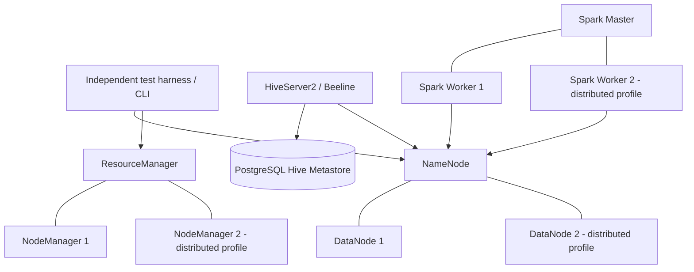

# Hadoop GHA Sandbox

A small, reusable integration-test framework for validating HDFS, YARN/MapReduce, Hive, and standalone Spark architectures in Docker Compose and CI/CD pipelines. It runs real service processes and real jobs, then validates their behavior with explicit assertions and retained diagnostics.

> **Not a production Hadoop distribution.** This project is a proof of concept for CI smoke tests and selected multi-worker behaviors. All containers in a Compose profile share one Docker host, kernel, disk subsystem, and network bottleneck. It does not test independent machine failures, high availability, Kerberos, rack-aware placement across real racks, or production-scale throughput.

## At a glance

- **Core:** HDFS read/write + real MapReduce execution through YARN.
- **Hive:** SQL via Beeline/HiveServer2 over a PostgreSQL-backed Hive Metastore, querying MapReduce data in HDFS.
- **Spark:** PySpark on a standalone Spark master/worker, reading the same HDFS input and comparing results with MapReduce.
- **Full stack:** Core + Hive + Spark concurrently in one Compose project.
- **Distributed:** Two DataNodes, two NodeManagers, two Spark workers; asserts live HDFS replicas and records executor hosts.
- **Scale:** A bounded workload runs automatically on relevant pull requests and pushes and on a daily schedule. It exercises multiple HDFS blocks/splits, YARN MapReduce counters/reducers, replication on distinct DataNodes, and Spark WordCount execution on multiple workers.

The uploaded diagnostics from runs `38378261082` / `38378261105` / `38378261106` establish the earlier core, Hive, standalone Spark, full-stack, and distributed baselines. The scale profile subsequently passed GitHub Actions run `38383224133`: 24 files and 19,200 records produced 48 MapReduce splits, all 48 HDFS blocks had two live replicas on distinct DataNodes, Spark WordCount used two worker hosts, and Spark/MapReduce outputs matched. The first resilience Actions run (`38387453329`) exposed a timing mismatch: Hadoop still reported the stopped DataNode as live after the harness 240-second wait. The fix isolates a 10-second NameNode heartbeat recheck setting to `docker-compose.resilience.yml`; the corrected profile still requires a subsequent live Actions pass.

## Architecture



All services within a selected profile share a Compose bridge network and resolve each other by service name, e.g. `namenode`, `resourcemanager`, `hive-server`, and `spark-master`. Compose overlays extend `docker-compose.yml`; they do not duplicate the base service definitions. Each GitHub-hosted Actions job has its own runner and Docker daemon. Separate matrix jobs do **not** form a cross-runner Hadoop cluster.

### Profile reference

| Profile | Compose files | What it tests | Default automation |
|---|---|---|---|
| `core` | `docker-compose.yml` | HDFS operations, worker registration, YARN MapReduce, expected counts | Every push/PR to `main` through the profile matrix |
| `hive` | Base + `docker-compose.hive.yml` | PostgreSQL availability, HiveServer2 query readiness, exact HiveQL results from HDFS | Every push/PR to `main` through the profile matrix |
| `spark` | Base + `docker-compose.spark.yml` | Spark worker registration, executor-host probe, HDFS write, Spark/MapReduce equality | Every push/PR to `main` through the profile matrix |
| `full` | Base + Hive + Spark overlays | Runs MapReduce, Hive, and Spark sequentially against one stack | Automatic on relevant code PRs/pushes to `main` and daily schedule; manual reruns optional |
| `distributed` | Base + Spark + distributed overlay | Two DataNodes/NodeManagers/workers; replication checked against live distinct DataNode endpoints; Spark scheduling probe on distinct hosts | Automatic on relevant code PRs/pushes to `main` and daily schedule; manual reruns optional |
| `scale` | Base + Spark + distributed + scale overlay | Bounded multi-file/multi-block input; MapReduce splits, counters and reducers; every input block replicated on distinct DataNodes; actual Spark WordCount participation on multiple hosts | Automatic on relevant code PRs/pushes to `main` and daily schedule; manual input overrides optional |
| `resilience` | Base + Spark + distributed + resilience-only heartbeat overlay | Uses a 10-second NameNode heartbeat recheck for this test only; stops DataNode 2; verifies HDFS read and MapReduce success with one live DataNode; restarts it and checks replica recovery | Automatic on relevant code PRs/pushes to `main` and daily schedule; manual reruns optional |

`test-hadoop.yml` runs the core/Hive/Spark matrix automatically on pull requests, pushes to `main`, and daily. Full-stack, distributed, scale, and resilience workflows are path-filtered for relevant code/configuration changes and also have daily scheduled runs. `workflow_dispatch` remains available as an optional rerun mechanism, not as a prerequisite for testing. Automated scale runs use 24 files × 800 lines, two reducers, two DataNodes and two Spark workers; optional manual inputs remain bounded and validated before containers start.

## Compatibility and versions

The image tags are deliberately pinned to a known, older compatibility set for this PoC:

| Component | Image / version used |
|---|---|
| Hadoop/HDFS/YARN/MapReduce | `bde2020/*:2.0.0-hadoop3.2.1-java8` (Hadoop 3.2.1, Java 8 image family) |
| HiveServer2 | `bde2020/hive:2.3.2-postgresql-metastore` |
| PostgreSQL metastore image | `bde2020/hive-metastore-postgresql:2.3.0` |
| Spark | `bde2020/spark-master:3.0.0-hadoop3.2` and matching worker image |
| Python in Spark image | Verified in the supplied passing Spark diagnostics as Python 3.7.7 |

These are community-maintained container images, not Apache-distributed production images. Before upgrading any tag, verify Java, Hadoop, Hive, Spark, and Python compatibility together, inspect the image-specific environment variable contract, run all profiles, and consider pinning image digests. The `HADOOP_MAPRED_HOME=/opt/hadoop-3.2.1/` settings must be updated with the Hadoop image version if you change the base tag.

## Validation evidence

See [Validation Evidence and Remaining Gates](docs/VALIDATION.md) for uploaded CI run IDs, exact assertions visible in their logs, the resilience timeout diagnosis, and the remaining live-CI gate.

## Scaling and adding components

The detailed [Scaling and Component Extension Guide](docs/SCALING_AND_COMPONENTS.md) defines staged test tiers, the bounded scale workload, the controlled DataNode outage/recovery profile, optional component candidates, and a contract for adding Compose overlays without turning the base cluster into an oversized stack.

## Requirements

- Docker Engine or Docker Desktop with Docker Compose v2 (`docker compose`, not the legacy `docker-compose` command).
- Bash and Python 3 on the host for the test harness and parser regressions.
- Enough memory for the chosen profile. The sum of the declared container ceilings is approximately 6 GB for full stack and 6.1 GB for distributed; these are limits, not expected measured usage. The Docker host needs additional memory for the daemon, filesystem cache, and other processes. If a container exits with code 137 or reports an OOM, measure and tune memory rather than blindly increasing timeouts.
- Network access to pull the pinned images on first run.

## Quick start: run a profile locally

Clone the repository and run commands from its root directory:

```bash
git clone https://github.com/anuxlab/hadoop-gha-sandbox.git
cd hadoop-gha-sandbox

# Fast static/regression checks (does not start Docker containers).
bash scripts/test-readiness-parsers.sh

# Run profiles; each command pulls images, starts the stack, runs assertions,
# saves diagnostics under artifacts/, and removes containers/volumes on exit.
bash scripts/run-profile.sh core
bash scripts/run-profile.sh hive
bash scripts/run-profile.sh spark
bash scripts/run-profile.sh full
bash scripts/run-profile.sh distributed
bash scripts/run-profile.sh resilience

# Parameterized multi-file/multi-block scale run (same defaults used by automated CI).
SCALE_FILES=24 SCALE_LINES_PER_FILE=800 bash scripts/run-profile.sh scale
```

You do not need to run every profile locally every time. Start with `core`, then the profile you changed. Use `full` for cross-component interoperability, `distributed` for multi-worker registration/replication, `scale` for many input splits and actual Spark WordCount processing across workers, and `resilience` for a controlled DataNode outage/recovery check.

Useful runner options:

```bash
# Skip image pulls when you already have the pinned images locally.
PULL_IMAGES=0 bash scripts/run-profile.sh core

# Use different startup/registration budgets when testing a slow local machine.
STARTUP_TIMEOUT=600 MAX_WAIT_SECONDS=300 bash scripts/run-profile.sh full

# On failure, retain containers and volumes for interactive inspection.
KEEP_CONTAINERS_ON_FAILURE=1 bash scripts/run-profile.sh distributed
```

The runner always stores `compose-ps.txt`, `compose-logs.txt`, and the resolved Compose configuration under `artifacts/<profile>-<timestamp>/`. When `KEEP_CONTAINERS_ON_FAILURE=1` is set and a profile fails, it retains containers/volumes; use the Compose project name and `COMPOSE_FILE` printed in the log to inspect them, then run `docker compose down -v --remove-orphans` with the same `COMPOSE_PROJECT_NAME` and `COMPOSE_FILE` values when done.

To configure a profile manually rather than using `run-profile.sh`, export the relevant Compose file list. For example:

```bash
export COMPOSE_FILE='docker-compose.yml:docker-compose.spark.yml'
docker compose config --quiet
docker compose up -d --wait --wait-timeout 450
bash scripts/run-wordcount.sh
bash scripts/run-spark-job.sh
docker compose logs --no-color
docker compose down -v --remove-orphans
unset COMPOSE_FILE
```

For the distributed profile, the Compose list is `docker-compose.yml:docker-compose.spark.yml:docker-compose.distributed.yml`; set `EXPECTED_DATANODES=2 EXPECTED_NODEMANAGERS=2 EXPECTED_SPARK_WORKERS=2 EXPECTED_REPLICATION=2` before running the test scripts.

## What the tests assert

### Core HDFS/YARN/MapReduce

`scripts/run-wordcount.sh`:

1. Reads the generated MapReduce configuration and fails immediately unless `mapreduce.framework.name=yarn`.
2. Verifies the `HADOOP_MAPRED_HOME` launch properties for the ApplicationMaster, mapper and reducer, and checks the MapReduce ApplicationMaster JAR exists in the submitter and active NodeManager images.
3. Waits for the expected live DataNodes and running NodeManagers.
4. Uploads a deterministic fixture to HDFS; removes stale output first.
5. Runs the Hadoop examples WordCount JAR through YARN, verifies the application final state is `SUCCEEDED`, checks `_SUCCESS`, and compares the complete normalized output with expected counts.
6. In profiles that define `EXPECTED_REPLICATION`, uses `hdfs dfs -setrep -w` and `hdfs fsck -files -blocks -locations` to verify live replicas and DataNode locations per block. In this fixture the input fits in one HDFS block.

### Hive

`scripts/run-hive-query.sh` waits for a real Beeline `SELECT 1`, creates an external table over the MapReduce output directory, executes the query, and compares all returned word/count pairs. The PostgreSQL healthcheck tests that the database accepts SQL; it intentionally does not wait for Hive's `VERSION` schema table. The custom Hive entrypoint writes XML into temporary files and atomically renames them, and disables automatic DataNucleus schema creation because the pinned metastore image pre-initializes schema objects under a different role.

The credentials in this repository are **test-only defaults** from the pinned community images. Do not reuse them in production, put secrets in committed files, or pass production data into this sandbox.

### Spark

`scripts/run-spark-job.sh` checks the Spark master's REST API for the expected number of `ALIVE` workers, prints Spark/Python versions, submits PySpark to the standalone master, checks HDFS `_SUCCESS`, and compares normalized Spark output with MapReduce output.

The job writes word/count records in Hadoop's tab-separated format rather than Python tuple formatting. It records two different kinds of evidence: a small scheduling probe (`/test/spark-worker-hosts`) and the distinct hosts that processed actual WordCount input partitions (`/test/spark-wordcount-worker-hosts`). The normal smoke test checks the scheduling probe; the scale profile asserts that actual WordCount input was processed on multiple hosts. The job persists intermediate counts and does not collect the full WordCount result into the driver.

### Distributed profile

The distributed overlay adds DataNode 2, NodeManager 2, and Spark worker 2. `run-wordcount.sh` checks worker registration and, when `EXPECTED_REPLICATION=2`, uses `fsck` output to assert the input block has two live replicas on distinct DataNode endpoints. The ordinary distributed smoke test also runs a Spark scheduling probe across worker hosts. The scale profile below adds a stronger assertion over the actual WordCount input partitions.

This is still a same-host simulation. Two DataNode containers do not simulate independent host or rack failures. For production-like failure domains, run workers on separate VMs/hosts or use a separately managed test cluster.

### Scale profile: multiple blocks, splits, records and Spark input workers

The `scale` profile adds `docker-compose.scale.yml` after the distributed overlay. It sets HDFS's block size and `dfs.namenode.fs-limits.min-block-size` to 16 KiB for this test profile only. Hadoop defaults the NameNode minimum block size to 1 MiB, so changing only `dfs.blocksize` is insufficient: the NameNode rejects the smaller blocks at `hdfs dfs -put`. The scale harness now checks both effective values before uploading any input and exits with a targeted error if the configuration did not apply. The test generator creates many separate text files; each file is constrained to exceed the block size, so the workload creates multiple blocks per file and multiple `FileInputFormat` splits without needing gigabytes of data. This lower minimum is solely for synthetic CI tests and must not be copied into production HDFS configuration.

```bash
# Defaults: 24 files × 800 lines = 19,200 input records.
SCALE_FILES=24 SCALE_LINES_PER_FILE=800 bash scripts/run-profile.sh scale

# A larger, still bounded workload: 48 files × 1,500 lines = 72,000 records.
SCALE_FILES=48 SCALE_LINES_PER_FILE=1500 bash scripts/run-profile.sh scale
```

The runner enforces `2 <= SCALE_FILES <= 128`, `600 <= SCALE_LINES_PER_FILE <= 2000`, and at most 128,000 records. These bounds prevent accidental unbounded loads in CI. It checks (1) every HDFS block has the requested number of live replicas on distinct DataNodes, (2) the number of input splits exceeds the number of files, (3) MapReduce's `Map input records` counter equals the generated record count, (4) normalized output counts equal the deterministic expected counts, and (5) the actual Spark WordCount input path was processed on at least two distinct executor hosts. It then compares Spark output with the MapReduce output.

The scale workflow `.github/workflows/test-scale.yml` runs automatically for relevant pull requests, pushes to `main`, and daily. Automated events use 24 files × 800 lines and two reducers. Optional manual reruns can override those values; local runs use `SCALE_FILES`, `SCALE_LINES_PER_FILE`, and `SCALE_REDUCERS`.

## GitHub Actions automation

All five test workflows run automatically; none relies on a manual button click:

- `.github/workflows/test-hadoop.yml`: core/Hive/Spark matrix on pull requests, pushes to `main`, and daily.
- `.github/workflows/test-full-stack.yml`: full stack on relevant pull requests/pushes and daily.
- `.github/workflows/test-distributed.yml`: distributed topology on relevant pull requests/pushes and daily.
- `.github/workflows/test-scale.yml`: bounded multi-block scale workload on relevant pull requests/pushes and daily; automated events use safe default inputs.
- `.github/workflows/test-resilience.yml`: DataNode outage/recovery integration test on relevant pull requests/pushes and daily.

Optional `workflow_dispatch` triggers remain for reruns or tuning the scale workload; normal CI does not depend on them. The schedules run on the repository's default branch and use UTC. GitHub may delay scheduled starts during periods of high load, so cron times are not exact guarantees. Full-stack, distributed, scale, and resilience runs are path-filtered on PR/push events to avoid starting Docker stacks for unrelated documentation-only edits.

The workflows use minimal `contents: read` permissions, bounded timeouts, failure-preserving `pipefail`, diagnostic collection with `if: always()`, artifact uploads, and cleanup. Diagnostics are retained for seven days for smoke/integration workflows and 14 days for scale/resilience runs.

To inspect recent status or watch a run with GitHub CLI:

```bash
gh run list --workflow test-scale.yml --limit 3 \
  --json databaseId,status,conclusion,url --jq '.[] | [.databaseId,.status,.conclusion,.url] | @tsv'
gh run list --workflow test-resilience.yml --limit 3 \
  --json databaseId,status,conclusion,url --jq '.[] | [.databaseId,.status,.conclusion,.url] | @tsv'
# Optional only: use gh workflow run <workflow.yml> to request a manual rerun.
```

All `schedule` triggers are enabled in the workflow files. GitHub scheduled workflows run from the default branch, and execution can be delayed during high load. If runner minutes or Docker memory become constrained, lower the schedule frequency while keeping PR/push checks automatic.

## Use this codebase as a framework for other HDFS components

The test harness is intentionally built around reusable assertions rather than tied to a single application. To add a new component or a new HDFS architecture:

1. **Create an overlay** such as `docker-compose.ozone.yml` or `docker-compose.my-service.yml`. Add only the new service/configuration there; preserve the shared base services. Join the existing `hadoop_net` and use service names for DNS.
2. **Define readiness properly.** Use healthchecks for process/service readiness, then add an application-level check (API call, SQL query, or HDFS/YARN command). `depends_on: condition: service_healthy` helps sequence startup but is not proof that a worker registered or a job succeeded.
3. **Create a harness** under `scripts/` or a dedicated `tests/` directory. It should wait with a deadline, check exit codes, make deterministic assertions about data/state, capture useful logs, and clean up after success/failure.
4. **Add a profile** to `scripts/run-profile.sh` if local reuse is useful, or define the explicit Compose file list and test step in a GitHub Actions workflow. If the profile changes the HDFS block size or worker count, isolate those overrides in a dedicated Compose overlay.
5. **Add regression coverage** to `scripts/test-readiness-parsers.sh` for known parsing/configuration failure modes. Never accept arbitrary three-digit HTTP statuses as readiness, ignore an error with `|| true` without a deliberate reason, or allow `tee` to mask a failed test.
6. **Keep the test deterministic.** Use small fixture data, explicit input/output locations, known expected outputs, bounded timeouts, and removal of stale paths.
7. **Collect diagnostics.** Preserve resolved Compose configuration, container state, all service logs, app/job status and harness output as artifacts, including on failure.
8. **Document the claim accurately.** Distinguish “service registered,” “job succeeded,” “replication verified,” “multiple workers actually executed tasks,” and “high availability tested.” These are different levels of evidence.

Example check for an overlay before starting a service:

```bash
docker compose \
  -f docker-compose.yml \
  -f docker-compose.my-service.yml \
  config --quiet
```

### Porting the tests to another CI/CD system

Any CI system with a Docker-capable Linux worker can run the same profiles. The essential pipeline steps are:

```bash
bash scripts/test-readiness-parsers.sh
docker compose config --quiet
PULL_IMAGES=1 bash scripts/run-profile.sh core
```

For a GitLab CI or Jenkins job, archive `artifacts/**/*` whether the profile passes or fails. Use `bash scripts/run-profile.sh full` for integration across all services, `bash scripts/run-profile.sh distributed` for the multi-worker profile, or `SCALE_FILES=24 SCALE_LINES_PER_FILE=800 bash scripts/run-profile.sh scale` for the bounded multi-block workload. The runner script pulls images by default, stores diagnostics, and tears down volumes unless failure-retention mode is explicitly selected.

## Scaling the simulation

Scale the *test properties you need to prove*, not simply the number of containers:

1. **Single-worker smoke tests:** cheap checks for config, HDFS I/O, YARN execution, Hive query behavior and Spark interoperability.
2. **Two-worker integration:** prove replication factor 2, live replica locations, two registered YARN nodes, two registered Spark workers and Spark task participation on distinct hosts.
3. **Multi-block / parallel workload tests:** the bounded `scale` profile generates files larger than the dedicated 16 KiB HDFS block size, creates multiple input splits, asserts MapReduce input counters, checks HDFS replicas for all blocks, and records worker hosts for the actual Spark WordCount data path. Do not infer parallelism from service count or from a scheduling-only probe.
4. **Resilience profile:** stops DataNode 2 after the baseline dataset is written, verifies the surviving replica can be read, runs a MapReduce job with the surviving DataNode, restarts DataNode 2, and checks restored replication. It runs as a separate automated profile to isolate disruption and diagnostics.
5. **Version matrix:** test compatible versions only. Use separate matrix jobs/profiles for tested Hadoop/Spark/Hive combinations; do not assume arbitrary cross-version compatibility.
6. **Larger runners / independent VMs:** if combined memory usage is unstable, use a larger hosted runner or a multi-host lab. To test NameNode HA, ResourceManager HA, rack awareness, Kerberos, true network partitions or independent host failures, a same-runner Compose profile is insufficient.

Path filters avoid launching full-stack, distributed, scale, and resilience Compose stacks for unrelated documentation-only changes. All workflows also run daily on a schedule; manual dispatch is only an optional rerun path, not required for testing. The scale workload uses bounded defaults to control CI resource usage.

## Troubleshooting

1. Download the `diagnostics-*` artifact from the failed job.
2. Read the harness log first (`run-wordcount.log`, `run-hive-query.log`, or `run-spark-job.log`) and identify the first failing assertion.
3. Inspect `compose-ps.txt` and the logs for the affected service; do not diagnose a downstream Spark/Hive missing-input error before checking whether the prerequisite MapReduce step passed.
4. For `MRAppMaster` class-not-found errors, inspect `mapred-site.xml`, the `HADOOP_MAPRED_HOME` environment properties, and the MapReduce application JAR path in the client and NodeManager containers.
5. For a Spark worker timeout, inspect the Spark master's `/json/` API and verify that workers are `ALIVE`; for the distributed smoke test, check the scheduling probe, and for the scale test inspect `run-scale-test.log` and the persisted WordCount data-worker host list.
6. For replication failures, inspect `hdfs fsck <file> -files -blocks -locations` and distinguish the configured replication factor (`hdfs dfs -stat %r`) from the actual live replicas.
7. For Hive startup failures, check PostgreSQL availability, metastore schema ownership/configuration and the first HiveServer2 error. A TCP-open port is not a successful SQL query.
8. Change one cause at a time. Do not increase timeouts to compensate for a wrong config value, missing JAR or schema error.

## Official documentation and source references

These are the primary technical references used for architecture and test design. Versioned links are chosen where possible to match the pinned runtime; always consult the documentation for the exact version you run.

### Apache Hadoop 3.2.1

- [HDFS Architecture](https://hadoop.apache.org/docs/r3.2.1/hadoop-project-dist/hadoop-hdfs/HdfsDesign.html) — NameNode, DataNodes, block storage, replication and placement.
- [HDFS User Guide](https://hadoop.apache.org/docs/r3.2.1/hadoop-project-dist/hadoop-hdfs/HdfsUserGuide.html) — administration, safemode, `fsck`, and storage behavior.
- [HDFS Commands Guide](https://hadoop.apache.org/docs/r3.2.1/hadoop-project-dist/hadoop-hdfs/HDFSCommands.html) — `hdfs fsck` and the `-files -blocks -locations` options.
- [HDFS Scalability Guide](https://hadoop.apache.org/docs/r3.2.1/hadoop-project-dist/hadoop-hdfs/HdfsUserGuide.html#Scalability) — HDFS capacity and scalability concepts (not a benchmark target for this single-host PoC).
- [Hadoop FileSystem Shell Guide](https://hadoop.apache.org/docs/r3.2.1/hadoop-project-dist/hadoop-common/FileSystemShell.html) — `hdfs dfs` operations.
- [YARN Architecture](https://hadoop.apache.org/docs/r3.2.1/hadoop-yarn/hadoop-yarn-site/YARN.html) — ResourceManager, NodeManager and application execution model.
- [MapReduce Tutorial](https://hadoop.apache.org/docs/r3.2.1/hadoop-mapreduce-client/hadoop-mapreduce-client-core/MapReduceTutorial.html) — job lifecycle, configuration and WordCount example.
- [Cluster Setup](https://hadoop.apache.org/docs/r3.2.1/hadoop-project-dist/hadoop-common/ClusterSetup.html) — configuration and cluster operation.

### Apache Hive 2.x compatible concepts

- [Hive Administrator's Manual](https://hive.apache.org/docs/latest/admin/adminmanual/) — service setup and configuration.
- [Hive Metastore Administration for Hive 2.x and earlier](https://hive.apache.org/docs/latest/admin/adminmanual-metastore-administration/) — metastore database and schema management. The exact container here is Hive 2.3.x; verify version-specific behavior before applying newer Hive 3/4 guidance.
- [Hive Installation / Beeline](https://hive.apache.org/docs/latest/admin/adminmanual-installation/) — HiveServer2 and Beeline basics.

### Apache Spark 3.0

- [Spark 3.0 Standalone Mode](https://spark.apache.org/docs/3.0.0/spark-standalone.html) — master/worker setup and standalone scheduling.
- [Spark 3.0 RDD Programming Guide](https://spark.apache.org/docs/3.0.0/rdd-programming-guide.html) — transformations, actions, partitions and distributed task execution.
- [Spark 3.0 Submitting Applications](https://spark.apache.org/docs/3.0.0/submitting-applications.html) — `spark-submit`, master selection, configuration and app arguments.
- [Spark 3.0 Configuration](https://spark.apache.org/docs/3.0.0/configuration.html) — executor/driver memory and core settings.

### CI, containers and image-specific behavior

- [GitHub Actions workflow syntax](https://docs.github.com/en/actions/reference/workflows-and-actions/workflow-syntax) — jobs, permissions, concurrency, paths and expressions.
- [GitHub Actions trigger events](https://docs.github.com/en/actions/reference/workflows-and-actions/events-that-trigger-workflows) — pull requests, pushes, `workflow_dispatch`, and schedules.
- [GitHub Actions workflow artifacts](https://docs.github.com/en/actions/concepts/workflows-and-actions/workflow-artifacts) — retaining diagnostics after a job finishes.
- [Docker Compose startup order and healthchecks](https://docs.docker.com/compose/how-tos/startup-order) — `service_healthy` dependencies.
- [Docker Compose environment variable precedence](https://docs.docker.com/compose/how-tos/environment-variables/envvars-precedence/) — resolving configuration and image-specific environment settings.
- [Big Data Europe `docker-hadoop` repository](https://github.com/big-data-europe/docker-hadoop), [docker-hive repository](https://github.com/big-data-europe/docker-hive), and [docker-spark repository](https://github.com/big-data-europe/docker-spark) — image-specific tags, entrypoints and environment variable contracts. These are image-maintainer references, not official Apache distribution artifacts.

## License

See [`LICENSE`](LICENSE).
